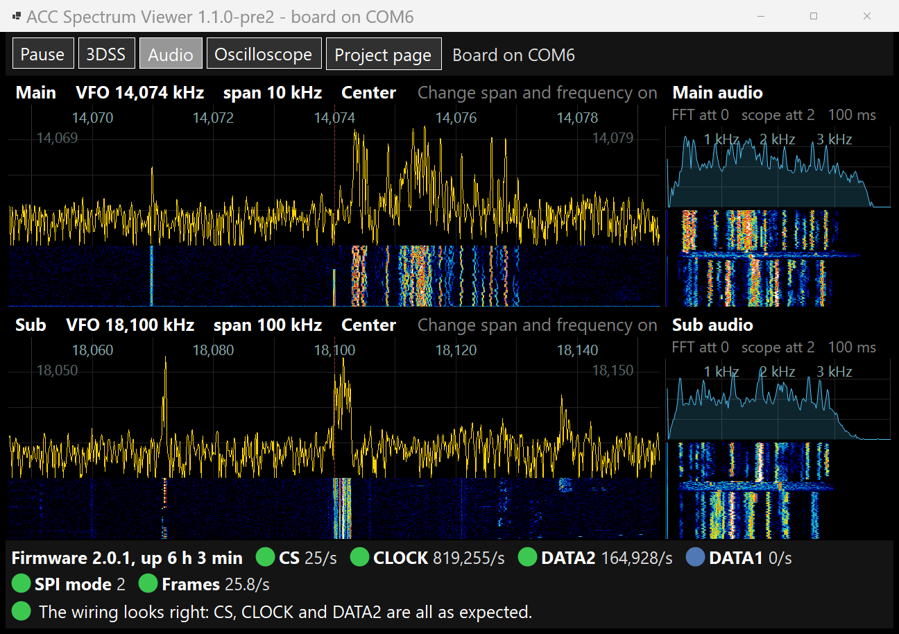

# Yaesu ACC spectrum

☕ [Buy me a coffee](https://www.paypal.com/cgi-bin/webscr?cmd=_xclick&business=mm5agm.software%40outlook.com&item_name=Yaesu+ACC+Spectrum&currency_code=GBP) if this is useful to you.

> This project was mostly written by Claude, Anthropic's AI model, working in
> Claude Code. Colin (MM5AGM) gave the guidance and suggestions, did the
> hands-on testing at the bench, and took the oscilloscope traces.

This reads a Yaesu's own scope data from its ACC socket, through an ESP32-S3
board over USB, so a PC program can draw the radio's spectrum and waterfall
for Main and Sub at the radio's full 25 frames a second. No SDR and no IF tap
is needed.

It works on my FTdx101MP, and on an FTDX10 with the same board, wiring and
firmware. FTDX10 support is the work of [Eugene YO9VA](https://github.com/Eugen68) ([#80](https://github.com/mm5agm/Yaesu_ACC_Spectrum/pull/80)). The FTDX10 has one receiver and keeps its tuning in other bytes of the
frame; the library and the viewer tell the two apart on their own (see
[The FTDX10](docs/protocol.md#the-ftdx10)). The FTDX101D is expected to send the
same as the MP. If you have one, I'd like to hear how it goes. The FT-710 doesn't need it: it
already sends its scope over USB.

## What's here

- **Firmware for the ESP32-S3.** It reads every frame from the ACC socket:
  the Main and Sub spectrum, both VFOs, the span, the placement and the audio
  scope. The frame layout is in [docs/protocol.md](docs/protocol.md).
- **[ACC Spectrum Viewer](viewer/README.md)**, a Windows program that finds the
  board, shows Main and Sub with their audio scopes, and checks every wire. **ACC Firmware Flasher**
  comes with it, so the firmware goes on without PlatformIO. Both are in the
  zip on the [releases page](https://github.com/mm5agm/Yaesu_ACC_Spectrum/releases).
- **The [YaesuAccScope library](library/README.md)** on nuget.org, so any .NET
  program can read the board. Its `ScopeRefiner` smooths the trace so weak
  signals stand out.
- **[Yaesu Web Control](https://github.com/mm5agm/Yaesu_Web_Control)** shows
  the ACC scope in its spectrum panels from
  [v2.5.5-pre1](https://github.com/mm5agm/Yaesu_Web_Control/releases/tag/v2.5.5-pre1),
  with a Refine control and a warning when the radio's scope LEVEL is too low.
- **Every ACC line checked on an oscilloscope**, with and without the ESP32
  connected, in [docs/scope-traces.md](docs/scope-traces.md). Every line is
  3.3 V logic on an FTdx101MP.
- **A measured comparison** with two SDRplay receivers on the radio's IF
  outputs, across every span on four bands, in
  [docs/comparison.md](docs/comparison.md).

## On my bench

Main on 14,074 kHz and Sub on 7,074 kHz, live from the ACC socket:

The same a moment later in the 3DSS view (press D), with the last 40 traces
drawn in perspective:

## Build one

Follow the **[setup guide](docs/setup-guide.md)**, step by step from the parts
to the scope on your PC. The parts, the wiring and how I checked the radio's
levels before connecting anything are in [docs/hardware.md](docs/hardware.md).
It's all at your own risk: read [docs/fuse-risk.md](docs/fuse-risk.md) first.

## Getting the best picture

In short:

- **Keep the radio's scope LEVEL at +20 or more on every band.** The radio
  stores LEVEL per band and per receiver. Too low, and the floor is cut off
  with the weak signals in it.
- **Use Refine 3 for general use, and Refine 5 for hunting weak signals.**
  Higher Refine shows more, but follows changes more slowly.
- **PEAK and SPEED don't matter** to the ACC data.

The details, span by span, are in
**[docs/best-picture.md](docs/best-picture.md)**.

## Against an SDR on the IF output

My FTdx101MP also feeds an SDRplay RSP1B from Main's IF output and an RSP1
from Sub's. On 2026-11-14 I recorded all three at the same moment, on every
span, on 160 m, the 31 m broadcast band, 20 m and 10 m. I then measured how
many weak signals each one showed, at the same false-alarm rate.

| Span | Which shows more weak signals, at Refine 3 |
|---|---|
| 1 and 2 kHz | ACC scope |
| 5, 10 and 20 kHz | Level |
| 50 and 100 kHz | SDR. Level at Refine 5 |
| 200 kHz, 500 kHz and 1 MHz | ACC scope |

- The band changed how big the gaps were, not which source was ahead.
- The SDRs follow changes faster. The radio's own scope takes over a second
  at the 1 kHz span.
- Only an SDR goes wider than 1 MHz.
- The RSP1 and RSP1B matched: the radio's IF noise sets the floor.

The comparison also found five things to fix in YWC's SDR display, and they're
fixed. The method, every table, what the results don't cover and the one gap
that isn't explained are in [docs/comparison.md](docs/comparison.md).

## Use at your own risk

**Everything in this repository is used entirely at your own risk.** Connecting
anything to the ACC socket can blow a fuse or damage the radio's main board, and the
repair may mean sending the radio back to Yaesu. If you damage your radio, or anything
else, that's your responsibility. The author accepts no liability for it, and nothing
here is approved or supported by Yaesu. There is no warranty of any kind, and the
information here may be wrong. Read [docs/fuse-risk.md](docs/fuse-risk.md) first.

## Documentation

| Document | What's in it |
|---|---|
| [Setup guide](docs/setup-guide.md) | Building and connecting the board, step by step |
| [Getting the best picture](docs/best-picture.md) | Scope LEVEL, Refine, and when an SDR does better |
| [Hardware](docs/hardware.md) | The parts, the wiring, the resistors, the safe first connection, erasing the ESP32 |
| [Oscilloscope traces](docs/scope-traces.md) | What every ACC line does on an FTdx101MP |
| [Fuse risk](docs/fuse-risk.md) | What can go wrong on the ACC socket, and how to avoid it |
| [Comparison](docs/comparison.md) | The ACC scope against an RSP1 and RSP1B, measured |
| [Protocol](docs/protocol.md) | The frame layout |
| [Bench notes](docs/bench-notes.md) | The measured levels and the first frames |
| [Plan](docs/plan.md) and [library plan](docs/library-and-ywc-plan.md) | How the project was planned |
| [Library](library/README.md), [viewer](viewer/README.md), [tools](tools/README.md) | Each part's own notes |

## Credits and background

This project builds on other people's work on the FTDX10 and FT-710. ratmandu
notes that the FTDX101 uses the same ACC data, but as far as I can find, no one
has yet published captures from an FTDX101MP or D. **None of their code is
used here.** What it takes from them is the physical side: which ACC pins carry the
scope data, the signal levels, the SPI clock and framing, the once-a-second
heartbeat on pins 11 and 12 that wakes the data up, and the finding that the lines
can be wired straight to an ESP32. The code is my own.

- [SLTPLAN/FTDX10_WF_HUB](https://github.com/SLTPLAN/FTDX10_WF_HUB): ESP32-S3
  firmware that shows the FTDX10's scope from the ACC socket. The pin mapping and
  the heartbeat here follow what it found.
- [SLTPLAN/FTDX10_WF](https://github.com/SLTPLAN/FTDX10_WF): the PC side of the
  same project.
- [sanjint.com: Yaesu FTDX10 scope](https://sanjint.com/yaesu-ftdx10-scope): a
  write-up of the ACC signals on the FTDX10.
- [ratmandu/YaesuWFTesting](https://github.com/ratmandu/YaesuWFTesting): the first
  published frame layout, worked out on an FT-710, with test tools.
- [CarrierWaveApp/sculan10-protocol](https://github.com/CarrierWaveApp/sculan10-protocol):
  a written description of the protocol Yaesu's SCU-LAN10 uses on the same lines.

Thanks to all of them. Their pages are the place to read up on how the data was
found.

FTDX10 support here is the work of [Eugene YO9VA](https://github.com/Eugen68). He captured the frames
on his own FTDX10, worked out where it keeps its tuning, and wrote the library
and viewer changes and their tests
([#80](https://github.com/mm5agm/Yaesu_ACC_Spectrum/pull/80)). Thank you,
Eugene.

## Layout

| Folder | What goes there |
|---|---|
| `firmware/` | My own ESP32-S3 firmware |
| `tools/` | Capture and analysis scripts |
| `captures/` | Short frame captures from the radio, with a note of the radio's settings |
| `docs/` | The guides, the hardware notes, the oscilloscope traces, the comparison, the protocol and the plan |
| `library/` | YaesuAccScope, a .NET library that reads the board's frames, for any program to use. See [library/README.md](library/README.md) |
| `viewer/` | ACC Spectrum Viewer, the Windows program that shows the scope and checks the wiring, and ACC Firmware Flasher, which flashes the firmware. See [viewer/README.md](viewer/README.md) |

The firmware, wiring, bench notes and library all live here. YWC uses the
library to show the ACC spectrum, from v2.5.5-pre1. See
[docs/library-and-ywc-plan.md](docs/library-and-ywc-plan.md).

## Rules

- **Receive-only.** Nothing here keys the radio.
- **Read [docs/fuse-risk.md](docs/fuse-risk.md) before touching the radio.** Pin 8
  is 13.8 V behind a fuse, and pins 9 and 10 are the PTT and SEND lines. ACC pins
  1, 7, 8, 9, 10 and 13 are never connected.
- **Plug and unplug with the supply off.**
- **Check the levels before connecting the ESP32.** Follow
  [Safe first connection](docs/hardware.md#safe-first-connection).
- **Use the S3's native USB.** The stream is 102.4 kB/s, more than a USB-serial
  chip at 921600 baud can carry.
- **Tools never open COM3 or COM4.** Those are the radio's ports. Name the
  ESP32's port explicitly.
- **No SLTPLAN code in this repo.** Their projects have no licence. Their
  firmware may be flashed as an outside comparison, but it isn't copied here,
  and my firmware is written from scratch, from what's known about the
  signals and from my own captures.

## Licence

GPL-3.0, the same as the other repositories. See [LICENSE](LICENSE). Its sections 15
and 16 also cover the lack of warranty and liability.

The library in `library/` has its own licence, LGPL-3.0, so other programs can
read the ACC data without copying code from here, and without having to be GPL
themselves. See [library/COPYING.LESSER](library/COPYING.LESSER).

The viewer's release zip also carries Espressif's esptool, unchanged, in its
own folder. esptool is GPL-2.0-or-later, from
<https://github.com/espressif/esptool>, and ACC Firmware Flasher runs it as a
separate program.
