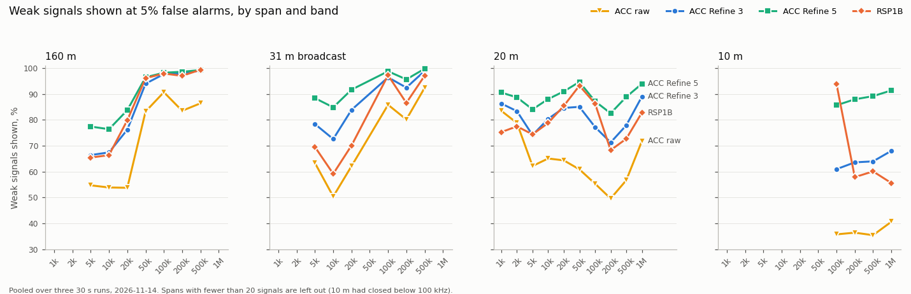
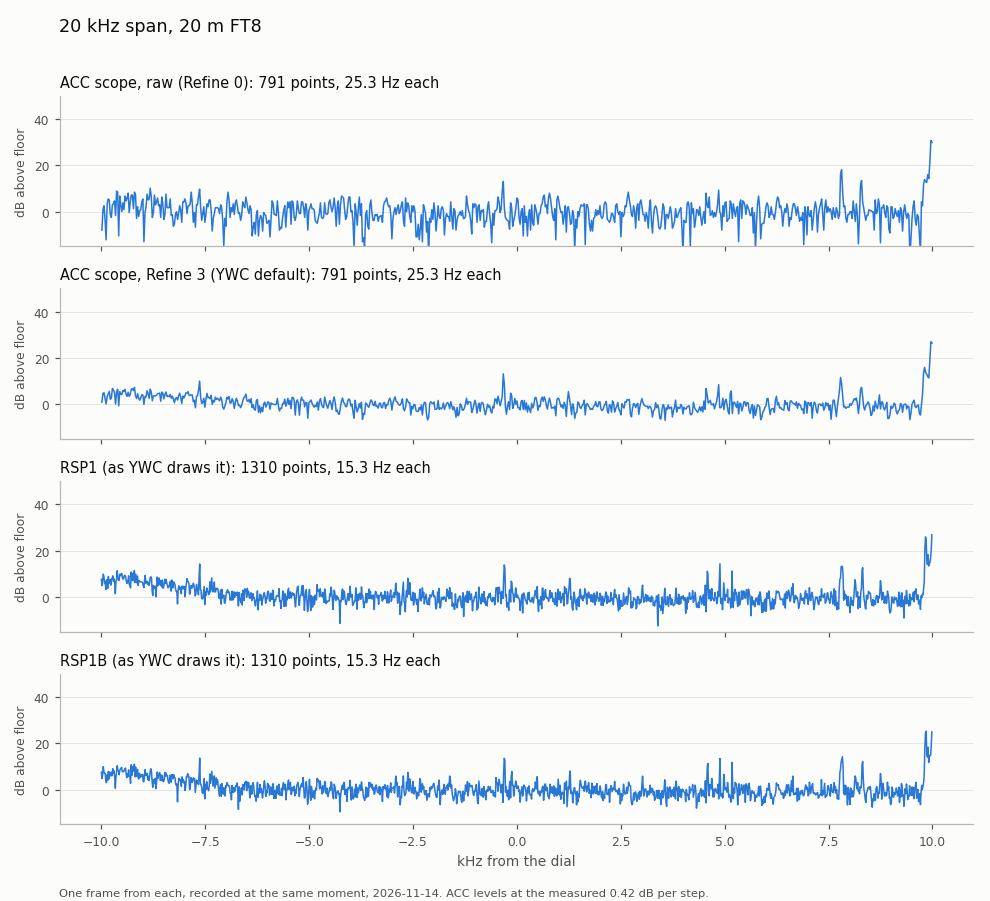
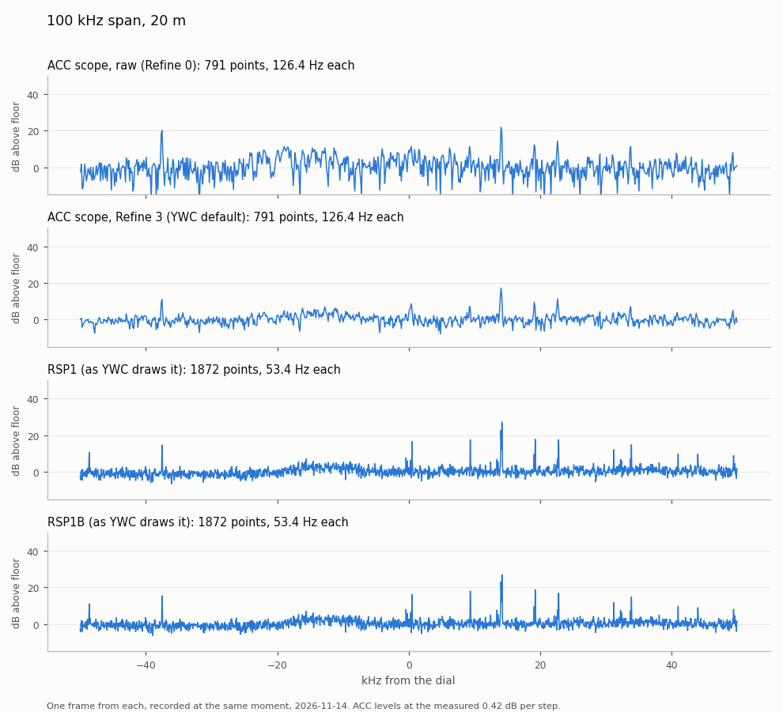

# ACC scope against the RSP1 and RSP1B

Measured on 2026-11-14 on my FTdx101MP. Receive only, off-air signals. Three
sources were recorded at the same moment:

- **ACC scope**: the radio's own scope rows from the ACC socket, through the
  ESP32-S3 board and the YaesuAccScope library.
- **RSP1**: an original SDRplay RSP1 on the Sub receiver's IF output
  (8.895 MHz), as Yaesu Web Control (YWC) draws it.
- **RSP1B**: an SDRplay RSP1B on the Main receiver's IF output (9 MHz), as YWC
  draws it.

Main and Sub were on the same frequency, with the same span and scope
settings, so all three saw the same signals. The aim is facts, not a sales
pitch. Where the ACC scope is worse, this says so, and where a result isn't
explained, it says that too.

## Summary

The question is which source shows more of the weak signals on the band. The
answer depends mostly on the **span**:

| Span | Which shows more weak signals | 20 m, ACC at Refine 3 against RSP1B |
|---|---|---|
| 1 and 2 kHz | **ACC scope** | 86% against 75%; 83% against 78% |
| 5, 10 and 20 kHz | **Level** at Refine 3. The ACC is ahead at Refine 5 | 74/74, 80/79, 85/85% |
| 50 and 100 kHz | **SDR** at Refine 3. Level at Refine 5 | 85/93, 77/86% |
| 200 kHz, 500 kHz and 1 MHz | **ACC scope** | 71/68, 78/73, 89/83% |

- **Band.** The band changes how big the gaps are, not who is ahead. No band
  turned any row of that table round. Where most signals were strong, as on
  160 m at 50 kHz and wider, every source showed nearly all of them, and the
  gaps closed. On the 31 m broadcast band both SDRs were further behind at 5 to
  20 kHz than anywhere else. That gap comes from weak signals among the
  sidebands of strong broadcast stations. Why the SDRs do worse there isn't
  known (see [Band by band](#band-by-band)).
- **Speed.** The ACC scope is slower. The radio's own scope takes over a second
  to follow a change at the 1 kHz span, and about 140 ms from 100 kHz up.
  Refine adds to that: Refine 5 adds about 200 ms to the time to show half a
  change, and 300 to 700 ms to the time to show 90% of it. The SDRs show half
  a change in 40 to 230 ms.
- **Refine 0 (the raw rows).** These are well behind everything else at every
  span except 1 and 2 kHz. Refine is what makes the ACC scope competitive.
- **RSP1 against RSP1B.** They matched. The radio's IF noise sets the floor,
  not the SDR.

Things only an SDR can do: spans wider than 1 MHz and the 15, 30 and 40 kHz
spans; radios other than the FTdx101 family; and changing span without
changing the radio's own scope. The ACC scope needs no IF tap and no SDRplay
service, and one board gives both Main and Sub.

## What was measured

### Weak-signal detection

This is the main measure, because it answers "will I see it?" In every frame,
for every weak signal, it asks whether the signal stands out of the floor more
than noise does at a known false-alarm rate. The same rules apply to every
source.

1. **Picking signals.** Each recording is cut into 5-second blocks. In each
   block, a signal is a peak at least 6 floor-spreads above the median in the
   block average of **both** pickers: one ACC receiver (raw rows) and one SDR.
   It must also be no more than 20 dB above the floor in the SDR's block
   average. That's what "weak" means here.
2. **Measuring them somewhere else.** Signals picked on ACC Sub and the RSP1
   are measured on ACC Main and the RSP1B, and the other way round. The noise
   that picked a signal is not the noise it's measured in, so no source is
   graded on its own luck. The tables give ACC Main and the RSP1B; ACC Sub and
   the RSP1 agree (see [Main against Sub, RSP1 against RSP1B](#main-against-sub-rsp1-against-rsp1b)).
3. **The statistic.** In each frame, for each signal: (highest point within a
   window round its frequency − the frame's floor median) ÷ the frame's floor
   spread. The window is the same width in hertz for every source: 1.5 times
   the coarsest source's point spacing.
4. **The threshold.** The same statistic at signal-free places in the same
   source's own frames, at least two windows from anything above 3 spreads in
   either picker. The threshold is its 95th percentile, so each source has
   exactly 5% false alarms. This is what makes the sources comparable. A
   smoother trace gets a lower threshold, and a rougher one a higher one.
5. **Detection** is the share of (signal, frame) pairs above the threshold.

The sources' frequency axes are lined up first, by cross-correlating their
long-term averages.

Notes on the method:

- A signal that is on for only part of a block, such as FT8, is counted in the
  frames where it's off too. That lowers every source's figure by the same
  amount, so the comparison holds, but no figure here reaches 100% for that
  reason alone.
- The ACC's slower response (see [Lag](#lag)) is inside the figures. At 1 and
  2 kHz, where it lags by over a second, a signal starting or stopping inside
  a block costs it frames. Even so, it comes out ahead at those spans.
- The picking needs a signal in a raw ACC average and in an SDR average.
  Neither kind of source can pick signals only it can see.

### Floor spread and clarity

- **Floor**: for each source, the half of the points with the lowest long-term
  average. The floor level is their median in each frame.
- **Floor spread**: half the distance between the 16th and 84th percentiles of
  the floor points in one frame, averaged over frames. For noise shaped like a
  bell curve, this is the standard deviation. It's what you see as grass on
  the trace.
- **Clarity**: in each frame, (strongest point − floor level) ÷ floor spread,
  averaged over frames. It's a ratio, so it doesn't depend on the dB scale. It
  depends on whichever single signal is strongest, though, and means nothing
  when nothing stands well above the floor. Detection is the better measure;
  clarity is kept because the earlier version of this page used it.

### Lag

How long each source takes to follow a sudden change. Main's attenuator was
switched between 0 and 18 dB by CAT command, at fixed intervals: every 3 s at
1 to 10 kHz spans, and every 1.5 s from 20 kHz up. ACC Main and the RSP1B (on
Main's IF) see each step at the same instant. For each source, the 5% of
points that change most are averaged and folded over every switch. The table
gives the time from the CAT command to 50% and to 90% of the step. That
includes the CAT command's own delay, which is the same for both.

### Settings

- **Radio**: ATT off and preamp off (IPO), on both receivers. Same frequency on Main and
  Sub, Center placement. One antenna. Scope LEVEL +23.5 on both receivers, on
  every band. LEVEL is stored per band, so it was set again on each band (see
  [Things to know](#things-to-know-before-you-rely-on-the-acc-scope)).
- **Bands**: 160 m (1840 kHz), the 31 m broadcast band (9650 kHz), 20 m
  (14075 kHz) and 10 m (28075 kHz). All ten of the radio's spans on each.
- **Recordings**: 30 seconds per band and span, three runs taken one after
  another. Each run went through all four bands. Times were 18:01 to 19:12
  UTC, after dark.
- **SDRs**: YWC develop with #342 (true 500 kHz span, 25 frames a second),
  #343 (half-band decimation filters) and #346 (AGC off, fixed gain reduction
  of 40 dB). The overload guard (#347) came later, so these recordings have
  the gain fixed throughout. The SDR frames came from YWC's own spectrum feed,
  as its pages receive them.
  - Up to 100 kHz: 16384-point FFTs at 125 kHz (7.6 Hz bins), thinned to at
    most 2048 points by keeping the strongest of each group.
  - From 200 kHz: 1024-point FFTs, one point per bin.
  - Both: smoothed by YWC's fixed weight of 0.3, at 25 frames a second.
- **ACC**: 791 points at every span, 25 frames a second. The raw rows were
  replayed through the same average that `ScopeRefiner` uses, at YWC's
  weights: Refine 1 = 0.6, 2 = 0.45, 3 = 0.3, 4 = 0.2, 5 = 0.12.

Tools: [tools/compare/](../tools/compare/).

## Results

### Detection, band by band

Percent of (signal, frame) pairs detected at 5% false alarms. Each cell gives
all three runs together, with the lowest and highest single run in brackets.
"Signals" counts signal-blocks: one signal in one 5-second block counts once,
added up over the three runs. Cells with fewer than 20 are left out.

**20 m, 14075 kHz.** Busy with FT8; the most signals, so the steadiest figures.

| Span | Signals | Raw | Refine 1 | Refine 3 | Refine 5 | RSP1B |
|---|---|---|---|---|---|---|
| 1k | 30 | 84 (82–85) | 84 (83–86) | 86 (85–87) | 91 (88–92) | 75 (71–78) |
| 2k | 100 | 79 (73–85) | 80 (74–86) | 83 (79–88) | 89 (87–92) | 78 (71–85) |
| 5k | 333 | 62 (60–64) | 67 (64–68) | 74 (73–75) | 84 (84–85) | 74 (72–77) |
| 10k | 337 | 65 (59–69) | 73 (68–77) | 80 (77–83) | 88 (86–91) | 79 (75–82) |
| 20k | 379 | 64 (62–68) | 76 (74–78) | 85 (84–86) | 91 (90–92) | 85 (84–87) |
| 50k | 458 | 61 (60–62) | 72 (71–73) | 85 (83–87) | 95 (94–96) | 93 (92–94) |
| 100k | 494 | 55 (48–57) | 65 (57–67) | 77 (65–79) | 87 (73–90) | 86 (72–90) |
| 200k | 391 | 50 (38–54) | 60 (50–65) | 71 (61–76) | 83 (73–87) | 68 (57–72) |
| 500k | 294 | 57 (52–60) | 67 (63–69) | 78 (74–80) | 89 (84–91) | 73 (70–75) |
| 1M | 161 | 72 (66–75) | 81 (77–84) | 89 (87–90) | 94 (93–95) | 83 (78–85) |

**160 m, 1840 kHz.**

| Span | Signals | Raw | Refine 1 | Refine 3 | Refine 5 | RSP1B |
|---|---|---|---|---|---|---|
| 5k | 66 | 55 (45–61) | 58 (49–64) | 66 (59–71) | 77 (74–79) | 65 (55–71) |
| 10k | 75 | 54 (43–58) | 61 (52–66) | 67 (61–72) | 76 (71–81) | 66 (58–70) |
| 20k | 86 | 54 (45–62) | 66 (61–72) | 76 (73–80) | 84 (83–85) | 80 (77–82) |
| 50k | 169 | 83 (71–94) | 90 (85–96) | 94 (92–97) | 96 (94–98) | 96 (94–98) |
| 100k | 81 | 91 (90–92) | 96 (95–98) | 98 (96–100) | 98 (96–100) | 98 (96–100) |
| 200k | 66 | 84 (82–87) | 95 (91–97) | 98 (96–100) | 99 (97–100) | 97 (93–100) |
| 500k | 61 | 86 (86–88) | 96 (96–97) | 99 (98–100) | 99 (99–100) | 99 (99–100) |

1 kHz, 2 kHz and 1 MHz had too few signals.

**31 m broadcast band, 9650 kHz.**

| Span | Signals | Raw | Refine 1 | Refine 3 | Refine 5 | RSP1B |
|---|---|---|---|---|---|---|
| 5k | 80 | 63 (56–71) | 69 (60–78) | 78 (69–88) | 88 (81–96) | 70 (64–75) |
| 10k | 223 | 50 (49–53) | 60 (58–63) | 73 (71–76) | 85 (82–89) | 59 (55–62) |
| 20k | 222 | 62 (59–64) | 74 (70–79) | 84 (81–94) | 92 (91–100) | 70 (47–72) |
| 100k | 161 | 86 (78–98) | 92 (88–100) | 96 (94–100) | 99 (98–100) | 97 (95–100) |
| 200k | 79 | 80 (74–90) | 88 (84–96) | 92 (88–99) | 96 (92–100) | 87 (81–98) |
| 500k | 31 | 92 (90–95) | 97 (96–99) | 99 (98–100) | 100 (100–100) | 97 (95–100) |

1 kHz, 2 kHz, 50 kHz and 1 MHz had too few signals.

**10 m, 28075 kHz.** The band was closed below 100 kHz: no signals at all.

| Span | Signals | Raw | Refine 1 | Refine 3 | Refine 5 | RSP1B |
|---|---|---|---|---|---|---|
| 100k | 124 | 36 (23–37) | 46 (30–48) | 61 (36–64) | 86 (49–89) | 94 (56–98) |
| 200k | 106 | 36 (33–84) | 48 (45–90) | 64 (61–92) | 88 (87–92) | 58 (55–91) |
| 500k | 97 | 35 (33–49) | 47 (44–60) | 64 (62–80) | 89 (88–95) | 60 (58–77) |
| 1M | 32 | 41 (38–54) | 51 (48–69) | 68 (65–82) | 91 (91–95) | 56 (52–74) |

The run-to-run ranges on 10 m are wide, because the band was closing.

### Lag

Milliseconds from the CAT command to 50% / 90% of an 18 dB attenuator step.
Measured on a steady carrier on 9685 kHz, on the same build as the detection
figures.

| Span | Raw | Refine 1 | Refine 3 | Refine 5 | RSP1B |
|---|---|---|---|---|---|
| 1k | 1080 / 1410 | 1110 / 1460 | 1175 / 1575 | 1310 / 1755 | 225 / 375 |
| 2k | 640 / 795 | 665 / 850 | 720 / 980 | 845 / 1420 | 215 / 440 |
| 5k | 320 / 385 | 345 / 430 | 390 / 585 | 525 / 1075 | 210 / 330 |
| 10k | 230 / 270 | 250 / 330 | 295 / 515 | 430 / 990 | 230 / 420 |
| 20k | 180 / 215 | 195 / 285 | 245 / 430 | 365 / 725 | 230 / 390 |
| 50k | 155 / 180 | 170 / 255 | 215 / 440 | 335 / 730 | 225 / 385 |
| 100k | 145 / 170 | 160 / 255 | 200 / 405 | 330 / 720 | 225 / 375 |
| 200k | 140 / 170 | 155 / 245 | 200 / 405 | 330 / 725 | 115 / 145 |
| 500k | 135 / 160 | 150 / 235 | 195 / 415 | 320 / 730 | 110 / 135 |
| 1M | 140 / 170 | 160 / 245 | 205 / 415 | 325 / 715 | 40 / 60 |

The raw ACC column is the radio's own scope plus the trip through the board,
so the second-long lag at 1 kHz is the radio's. The RSP1B takes the IF
directly, so its lag is YWC's FFT and smoothing.

### Clarity, 20 m

The ACC at each Refine step divided by the RSP1B, from the same recording.
Above 1 means the ACC scope's strongest signal stands out more. Mean over the
three runs.

| Span | Raw | Refine 1 | Refine 3 | Refine 5 |
|---|---|---|---|---|
| 1k* | 0.63 | 0.63 | 0.67 | 0.79 |
| 2k | 0.70 | 0.74 | 0.83 | 1.01 |
| 5k | 0.62 | 0.75 | 0.94 | 1.25 |
| 10k | 0.57 | 0.80 | 1.09 | 1.55 |
| 20k | 0.49 | 0.67 | 0.92 | 1.30 |
| 50k | 0.37 | 0.50 | 0.67 | 0.92 |
| 100k | 0.27 | 0.38 | 0.55 | 0.82 |
| 200k | 0.44 | 0.65 | 0.97 | 1.52 |
| 500k | 0.61 | 0.92 | 1.37 | 2.10 |
| 1M | 0.63 | 0.91 | 1.29 | 1.78 |

\* No signal stood 10 dB above the floor at 1 kHz, so that row measures noise
peaks, not a signal. The ACC is ahead at 1 kHz in detection, and in the
[carrier picture](#pictures) below.

Clarity agrees with detection on the pattern: SDR ahead at 50 and 100 kHz,
ACC ahead from 200 kHz up. It's harsher on the ACC at narrow spans, because
it follows the single strongest signal.

### Main against Sub, RSP1 against RSP1B

- **RSP1 and RSP1B**: clarity within 5% of each other at every span and band,
  except two cases:
  - 10 m at 5 to 50 kHz (0.84 to 0.91). The band was closed there, so that's
    noise against noise.
  - 160 m at 1 MHz (2.12). That was a false signal on the RSP1, caused by
    overload. It's fixed now (see [Problems found and fixed](#problems-found-and-fixed)).
- **ACC Main and Sub**: within about 1%, except on the broadcast band (6 to 9%
  either way).

## Why the results differ

The ACC scope always has 791 points. How an SDR's points compare depends on
the span:

| Span | ACC Hz per point | SDR Hz per point | SDR points |
|---|---|---|---|
| 1k | 1.3 | 7.6 | 131 |
| 2k | 2.5 | 7.6 | 262 |
| 5k | 6.3 | 7.6 | 655 |
| 10k | 12.6 | 7.6 | 1311 |
| 20k | 25.3 | 15.3 | 1310 |
| 50k | 63 | 31 | 1638 |
| 100k | 126 | 53 | 1872 |
| 200k | 253 | 244 | 819 |
| 500k | 632 | 488 | 1024 |
| 1M | 1264 | 977 | 1024 |

- **1 and 2 kHz.** The ACC has points 1.3 and 2.5 Hz apart, against the SDR's
  7.6 Hz bins. A narrow signal is a sharp spike on the ACC, and a hump spread
  over several points on the SDR. A steady carrier at 1 kHz was 2.5 Hz wide
  (6 dB down) on the ACC and 15.3 Hz on both SDRs.
- **5 to 20 kHz.** Similar resolution on both, and the same smoothing weight
  at Refine 3 (0.3) as YWC uses on SDR frames. So they come out level.
- **50 and 100 kHz.** YWC still uses 7.6 Hz FFT bins here, and keeps the
  strongest of each group of 4 to 7 bins. A narrow signal keeps its full
  height in a point 31 or 53 Hz wide, while the ACC's points are 63 and
  126 Hz. That fits the SDR being ahead. It wasn't tested separately.
- **200 kHz and up.** YWC switches to a 1024-point FFT, one point per bin,
  with nothing to thin. Each frame comes from a few milliseconds of signal,
  so the trace is a rougher snapshot. The lag table shows the same thing from
  the other side: from 200 kHz the SDR follows a change in 40 to 115 ms,
  against 225 ms below that. The radio's scope appears to integrate more per
  row. That fits the ACC being ahead here. It wasn't tested separately, and
  averaging several FFTs per frame in YWC might close the gap.

Refine trades speed for smoothness. Each step lowers the floor spread, so
weak signals clear the 5% threshold more often, and adds lag. At 5 to 20 kHz,
Refine 5 puts the ACC 6 to 10 points ahead of the SDR on 20 m. The cost is
120 to 135 ms more than Refine 3 to show half a change, and 300 to 490 ms more
to show 90% of it.

## Band by band

- **20 m** had the most signals, and gives the pattern in the summary.
- **160 m**: the same pattern at 5 to 20 kHz. From 50 kHz up, most signals
  were strong enough that every source at Refine 1 and above found 90% or
  more, so the differences disappear. That's a ceiling, not a tie in
  sensitivity.
- **31 m broadcast band**: at 50 kHz and wider, level, near the ceiling. At 5,
  10 and 20 kHz the ACC at Refine 3 was 8 to 14 points ahead of the RSP1B (78
  against 70, 73 against 59, 84 against 70). That's more than on any other
  band. The RSP1 on Sub showed the same gap as the RSP1B on Main, so it isn't
  one SDR. I reran the detection with filters:
  - **Not the AGC.** It was off.
  - **Not the strong carriers' skirts.** Leaving out every weak signal within
    1 kHz of a point 25 dB or more above the floor left the gap as it was.
  - **Not the floor's shape.** The floor slopes across the span on this band,
    but by the same amount on all three sources.
  - **It's where the weak signals sit.** Keeping only signals in the middle
    45% of the span removed the gap at 5 kHz (level) and reversed it at 20 kHz:
    67 and 61% for the ACC, against 77 and 75% for the RSP1B, in the two runs
    with signals there. At 10 kHz the gap stayed (69 against 63, 64 against
    56). On 20 m the middle of the span gave the same figures as the whole
    span, within 2 points.

  Away from the centre, the weak signals on this band sit among the
  sidebands of strong AM stations, inside the span or just past its edge. At
  the 10 kHz span the strongest signal was 50 dB above the floor. So the gap is
  about weak signals inside strong broadcast modulation, not about the band
  itself. Why the SDRs detect fewer of them there isn't tested. It's from one
  evening, with 80 to 223 signals per span.
- **10 m** was closed below 100 kHz after dark. At 100 kHz the RSP1B was
  ahead, by more than on 20 m: 94 against 61, with very wide run ranges. From
  200 kHz up the ACC was ahead, as on 20 m.

  Earlier that afternoon, 16:33 to 17:26 UTC, 10 m was open at narrow spans.
  There the ACC was ahead at 2 to 20 kHz: Refine 3 found 70 to 84%, the RSP1B
  49 to 58%. But the SDRs' AGC was still on then, and the AGC was later found
  to cost the SDRs weak signals on a busy band (see below). So that run
  doesn't count as a clean comparison, and 10 m at narrow spans is unmeasured
  with the current YWC.

## Problems found and fixed

Measuring the sources against each other turned up these. All are fixed in YWC
develop, and will be in the next release after v2.5.5-pre4.

- **The SDRs' AGC lost weak signals on a busy band** (#346). SDRplay's default
  is AGC on. On the broadcast band at 20 kHz, the RSP1B found 19% and 18% of
  the weak signals with it on, against 46% and 55% with it off. That was an
  interleaved A/B on the same build. On 20 m it made no difference. The gain
  is now fixed.
- **A fixed gain can overload** (#347). On 160 m at 1 MHz at night, the
  medium-wave band in the span overloaded the RSP1 and drew a false signal
  46 dB high at 1389 kHz. YWC now listens for the SDRplay API's overload
  reports:
  - While an overload lasts, it raises the gain reduction 3 dB at a time.
  - After 30 s without one, it lowers it again.
  - With this, the false signal was 8 to 10 dB, as it was with the AGC on.
  - It costs no sensitivity: with the gain reduction raised by 15 dB, the 20 m
    floor fell by 14.6 dB, so the radio's noise still set the floor.
  - Where it acts: I stepped through all ten spans on all four bands that
    night, a minute each, and logged the guard. It acted only on 160 m at
    1 MHz. Everywhere else the gain stayed fixed, so the detection figures
    above, which were recorded before the guard existed, are what YWC gives
    now.
- **Signals from outside the span folded in** (#343). At the 1 MHz span a
  1089 kHz medium-wave station showed 46 to 50 dB high at +241 kHz on 160 m.
  YWC now uses the API's half-band decimation filters.
- **The SDR's 500 kHz span showed 1 MHz** (#342). It was found by lining the
  SDR's frequency axis up against the ACC's. The same change took YWC's SDR
  frames from 10.4 to 25 a second.
- **ACC levels in dB** (#341). YWC now uses the measured 0.42 dB a step.
- **A low scope LEVEL clips the ACC floor** (#344). YWC now warns "LEVEL too
  low" when 5% or more of the points sit on the bottom steps.

## Things to know before you rely on the ACC scope

- **Keep the radio's scope LEVEL up, on every band.** The ACC rows are the
  radio's display data, after its LEVEL setting. LEVEL is stored per band and
  per receiver, so setting it on 20 m doesn't set it on 160 m. The floor clips
  at step 1, and a clipped floor hides weak signals.
  - At +05, 10.7% of the points were on the bottom steps on 160 m, 1.5% on
    20 m and 15.1% on 10 m.
  - At +23.5 it was 0.0 to 0.2% on every band. The worst moment was 2.2%, at
    the 1 kHz span on 10 m.
  - The strongest signals seen never reached the top of the scale.
- **PEAK and SPEED make no difference** to the ACC rows. Switching PEAK
  between 0 and 3, and SPEED between 0, 2 and 4, left the floor and its
  roughness unchanged.
- **Choose Refine for the span.** See the [Summary](#summary) and
  [Lag](#lag).
- **The dB scale is approximate.** It's about 0.42 dB a step from the
  attenuator, and about 0.46 from the LEVEL control. Measured on a steady AM
  carrier on 9685 kHz:
  - ATT was switched between off and 6, 12 or 18 dB every 1.5 seconds for
    24 seconds. Switching back and forth cancels slow fading. The carrier
    dropped 13.2 ± 2.4, 27.5 ± 3.6 and 44.0 ± 2.5 steps. The best fit is
    2.38 steps per dB, or 0.42 dB a step. That trusts the radio's attenuator
    to be 6, 12 and 18 dB.
  - LEVEL switched between +23.5 and +13.5 moved the carrier 21.6 ± 2.7
    steps.
  - The floor moved less than strong signals did, so the scale may squash a
    little near the bottom. ACC figures in dB carry that uncertainty.
    Detection and clarity don't depend on it.

## Fixed facts

| | ACC scope | RSP1 | RSP1B |
|---|---|---|---|
| **What it needs** | The ESP32-S3 board on the ACC socket. One board gives Main and Sub | An IF output from the radio, the SDR, SDRplay's API service | The same |
| **Radios** | FTdx101MP; the FTDX101D and FTDX10 are expected to work | Any radio with an IF output | Any radio with an IF output |
| **Level data** | One byte a point: 256 steps, about 0.42 dB each | 12-bit ADC, levels in dB from an FFT | 14-bit ADC, levels in dB from an FFT |
| **Absolute level** | Not calibrated. Moves with the radio's scope LEVEL | Not calibrated. Fixed gain, backed off only while the ADC is overloaded | The same |
| **Spans** | The radio's ten: 1, 2, 5, 10, 20, 50, 100, 200, 500 kHz and 1 MHz | 1 kHz to 2 MHz in YWC, including 15, 30 and 40 kHz | The same |
| **Changing span** | Changes the radio's own scope too | Doesn't touch the radio | The same |
| **Frames a second** | 25 | 25 | 25 |
| **Width of a steady carrier, 1 kHz span (6 dB down)** | 2.5 Hz | 15.3 Hz | 15.3 Hz |
| **Carrier position against the dial, 1 kHz span** | +1.0 Hz | +3.5 Hz, after YWC's −44 Hz trim for its 5 ppm crystal | +4.3 Hz, no trim |
| **Frequency reference** | The radio's own, so it always agrees with the dial | Its own plain crystal; needs a trim | Its own TCXO |

Where the 9685 kHz carrier peaks at a 1 kHz span was measured to a fraction of
a point. At 20 kHz the ACC trace sat one point (25 Hz) lower than the SDRs'
across the whole span, so the sources agree to within a point, not better.

## Pictures

Each picture shows one frame from each source, recorded at the same moment.
Levels are dB above each source's own floor, because none of them is
calibrated.

**1 kHz span, a steady carrier** (9685 kHz, from an earlier recording that
afternoon). The ACC scope draws the carrier as a spike a couple of hertz wide,
with the AM sidebands either side as separate lines. The SDRs, at 7.6 Hz a
point, draw a hump 15 Hz wide.

**20 kHz span, 20 m FT8.** Raw ACC rows are visibly rougher. At Refine 3 the
ACC floor is about as smooth as the SDRs', and the FT8 signals look the same.

**100 kHz span, 20 m.** Here the SDRs win: 1872 points to the ACC's 791, each
keeping the strongest of its group of FFT bins, so narrow signals stay tall.

There are also [5 kHz](images/compare/span-5k-ft8.png) and
[1 MHz](images/compare/span-1m.png) pictures.

## Limits

- **One radio, one antenna, one evening.** Band conditions changed during the
  hour: 10 m closed, and the runs disagree more there. The three runs were
  interleaved across bands, so slow changes hit every source alike, but they
  can't be averaged away.
- **Real signals, not a signal generator.** The signals weren't controlled. A
  strong signal right next to a weak one wasn't tested.
- **The broadcast-band gap at 5 to 20 kHz** is tied to weak signals among
  strong AM sidebands, but why the SDRs do worse there isn't explained.
- **10 m at narrow spans** was only measured with the SDRs' AGC on.
- **The reasons in [Why the results differ](#why-the-results-differ)** fit the
  data, but weren't tested one by one.
- **The ACC's dB scale is approximate** (see above). Nothing in the detection
  or clarity figures depends on it.
- **Cheap dongles.** I haven't got one. An 8-bit RTL-SDR has much less dynamic
  range than either RSP, but that isn't measured here.
- **RSP1 against RSP1B.** They matched, because the radio's IF output sets the
  noise floor, not the SDR. The RSP1B's 14 bits against the RSP1's 12 don't
  show here. The RSP1's crystal does show: it needs YWC's frequency trim.
- **Transmit.** Nothing here transmits.
- **Other radios.** Only my FTdx101MP.
